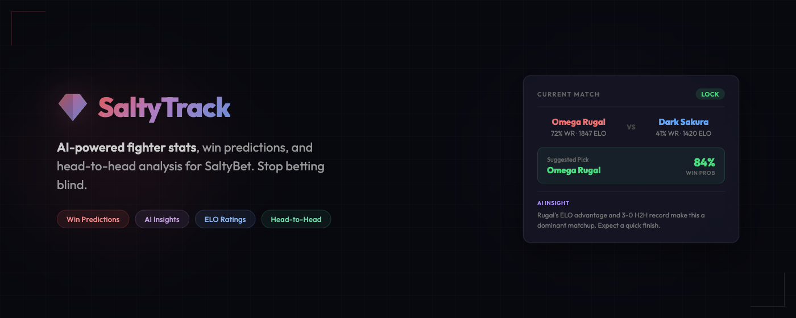

  

  <strong>Know the fighters. See the matchup. Track the predictions.</strong> 
  <a href="https://saltytrack.com/">Explore SaltyTrack</a> ·
  <a href="https://chromewebstore.google.com/detail/saltytrack-saltybet-ai-pr/mgniolfcklfofnbdojljgkboefncilml">Install the Chrome extension</a> ·
  <a href="https://github.com/amnicator/saltytrack-public/issues/new/choose">Share feedback</a>

## What is SaltyTrack?

[SaltyBet](https://www.saltybet.com/) streams computer-controlled fighting game matches. Viewers can predict the winner using fictional Salty Bucks. **SaltyTrack** is a companion website and Chrome extension that helps you make sense of those matches: it shows fighter records, head-to-head history, and predictions based on recorded results. The [Accuracy Dashboard](https://saltytrack.com/accuracy) tracks how those predictions perform, including misses.

SaltyTrack is an independent project. It is not affiliated with or endorsed by SaltyBet. Predictions are estimates, and SaltyBet does not involve real-money betting.

## Install and use the extension

1. Open the [SaltyTrack listing in the Chrome Web Store](https://chromewebstore.google.com/detail/saltytrack-saltybet-ai-pr/mgniolfcklfofnbdojljgkboefncilml) and select **Add to Chrome**.
2. Visit [saltybet.com](https://www.saltybet.com/) in Chrome. When a match is available, the SaltyTrack overlay appears on the page with fighter stats, matchup history, and a prediction.
3. Use the extension icon to check its status or open its settings. Explore the [website](https://saltytrack.com/) for deeper analysis.

The extension is free. You do not need to install software from this repository or create a SaltyTrack account.

## Find your way around the website

| Page | Use it for |
| --- | --- |
| [Home](https://saltytrack.com/) | See the current match and jump into the main tools. |
| [Explorer](https://saltytrack.com/explore) | Discover trends, upsets, streaks, and other patterns in the match history. |
| [Fighters](https://saltytrack.com/fighters) | Find a fighter and review its record and recent results. |
| [Matchup](https://saltytrack.com/matchup) | Compare two fighters and their head-to-head history. |
| [Tiers](https://saltytrack.com/tiers) | Browse fighters by SaltyBet tier. |
| [Leaderboard](https://saltytrack.com/leaderboard) | Compare fighter rankings and performance. |
| [Accuracy](https://saltytrack.com/accuracy) | Check how SaltyTrack's recorded predictions have performed. |
| [Insights](https://saltytrack.com/insights) | Read guides and analyses about SaltyBet and SaltyTrack. |

## Feedback and issues

This is SaltyTrack's **public feedback and information repository**. [Open an issue](https://github.com/amnicator/saltytrack-public/issues/new/choose) to report a bug, suggest a feature, or share general feedback. Search existing issues first, and include the relevant SaltyTrack page or extension version when it helps explain the problem. GitHub requires an account to post an issue.

For incorrect data on a particular website page, you can also use that page's **Report inaccuracy** link. Please do not post passwords, personal information, or security vulnerabilities in a public issue; see [Security reporting](SECURITY.md).

SaltyTrack's application and extension are developed in a private repository. This public repository does not contain their source code or accept code contributions. It contains user information, issue forms, and SaltyTrack branding assets.
